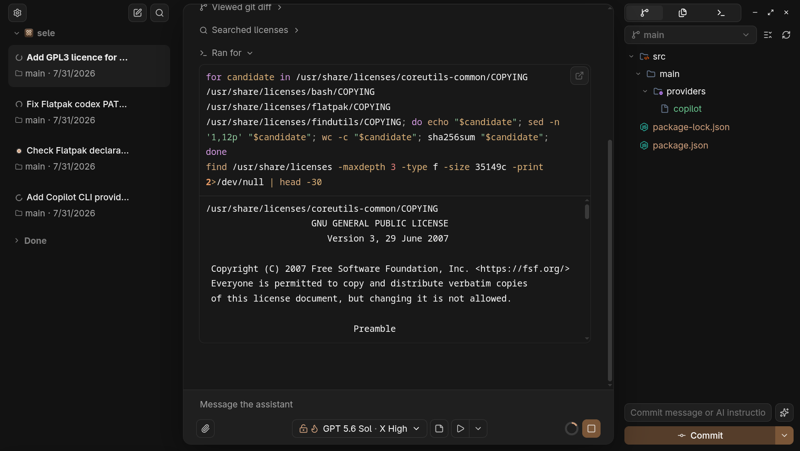

# Sele

A focused desktop workspace for working with AI coding agents across local projects.



Sele keeps conversations, project context, diffs, file editing, and terminal sessions together
in one desktop app. It supports OpenAI Codex, Anthropic Claude Code, GitHub Copilot, and
OpenCode.

## Install

Download the latest Windows, macOS, or Linux package from
[GitHub Releases](https://github.com/Chipi-Chapa-Corp/sele/releases/latest).

Install the Linux Flatpak from Sele's update repository:

```bash
flatpak install --user https://chipi-chapa-corp.github.io/sele/flatpak/sele.flatpakref
```

The repository descriptor is also available as
[`sele.flatpakrepo`](https://chipi-chapa-corp.github.io/sele/flatpak/sele.flatpakrepo) and
as a downloadable asset on each GitHub Release.

Install on macOS with Homebrew:

```bash
brew tap chipi-chapa-corp/sele https://github.com/Chipi-Chapa-Corp/sele.git
brew install --cask chipi-chapa-corp/sele/sele
```

Upgrade a Homebrew installation with:

```bash
brew update
brew upgrade --cask chipi-chapa-corp/sele/sele
```

The cask tracks numbered stable releases and verifies the DMG checksum. Direct DMG
downloads remain available for installations without Homebrew.

> [!IMPORTANT]
> macOS builds are currently unsigned. If Gatekeeper says Sele is damaged, corrupted, or
> cannot be opened, remove the download quarantine and start the app again:
>
> ```bash
> sudo xattr -dr com.apple.quarantine /Applications/Sele.app
> open /Applications/Sele.app
> ```

Sele uses the coding-agent CLIs, Git, and shell installed on your host system. Install and
authenticate the CLI you want to use before starting Sele.

```bash
codex --version
claude --version
copilot --version
opencode --version
```

Desktop process environments may not include the same `PATH` as your interactive terminal.
If Sele cannot find a provider, or the provider lookup resolves back to Sele and opens duplicate
windows, point Sele at the real provider executable explicitly. For Codex:

```bash
flatpak override --user --env=SELE_CODEX_PATH="$(command -v codex)" com.chipichapa.sele
launchctl setenv SELE_CODEX_PATH "$(command -v codex)"
```

If the Flatpak cannot see a host Copilot install, point Sele at that executable as well:

```bash
flatpak override --user --env=SELE_COPILOT_PATH="$(command -v copilot)" com.chipichapa.sele
```

Claude Code can be configured the same way when it is outside Sele's desktop `PATH`:

```bash
flatpak override --user --env=SELE_CLAUDE_PATH="$(command -v claude)" com.chipichapa.sele
launchctl setenv SELE_CLAUDE_PATH "$(command -v claude)"
```

OpenCode also supports an explicit executable path:

```bash
flatpak override --user --env=SELE_OPENCODE_PATH="$(command -v opencode)" com.chipichapa.sele
launchctl setenv SELE_OPENCODE_PATH "$(command -v opencode)"
```

Authenticate Claude Code with `claude auth login` before using the Claude provider.

With Claude Code 2.1.281 or newer, use **Settings → Providers → Claude → Accounts** to
add and switch subscription accounts on Linux, macOS, or Windows. Accounts share the
same local chats, settings, plugins, and memory. Sele selects only the credential store
using `CLAUDE_SECURESTORAGE_CONFIG_DIR`; Claude stores credentials in Keychain on macOS
and account-specific files elsewhere. **Default** uses your existing CLI authentication.
Adding an account leaves the current account selected until sign-in succeeds. Switching
stops running Claude turns in that environment; existing chats can then resume with the
selected account. If browser authorization returns a code, paste it into the account dialog.
Usage lookups use a separate per-account cache so Claude cannot reuse another account's
limits. This background lookup does not create chats or change the shared chat configuration.
Codex account switching remains Linux-only.

For Copilot, start `copilot` once and use `/login` if the CLI is not already authenticated.

For OpenCode, connect at least one model provider with `opencode auth login`. Sele runs a
private, authenticated `opencode serve` process for each supported source. OpenCode works on
the host, in Sele's current container, and in Distrobox or Toolbox sources. Separately selected
remote SSH, Docker, and Podman sources are not currently exposed because their loopback server
is not safely reachable by Sele.

Sele supports **OpenCode 2 only**, shown as **OpenCode**. OpenCode 1 installations are ignored.
Install `@opencode/cli`, or set `SELE_OPENCODE_PATH` to an OpenCode 2 executable. Sele also
finds its managed installation and v2 binaries shadowed by an older `opencode` on `PATH`.

The new-chat composer stacks update suggestions for all installed providers in the selected
environment. OpenCode updates track the v2 CLI package. Existing migrated v2 profiles and
conversation history are retained; Sele exposes one OpenCode chat list. When preparing a
profile for the first time, Sele backs up settings and saved credentials and seeds a separate
database from existing OpenCode data. The original database is untouched. Existing
`OPENCODE_DB` overrides are respected. Custom v1 plugins need v2 implementations; expired
credentials or unsupported remote MCP OAuth credentials may require sign-in again.

## Development

For the source-backed ChatGPT desktop and Codex app/CLI feature audit, see the
[compatibility table](docs/compatibility/README.md), including a searchable HTML
view, CSV, source coverage, and reproducible protocol/feature inventories.

Requires Node.js 22.

```bash
npm install
npm run dev
```

Run the project checks with:

```bash
npm run lint
npm run typecheck
npm run build
```

Regression tests live beside the source they cover (`*.test.mjs`); use the named
`npm run test:*` commands in `package.json` to run a focused suite. Electron and
worker integration checks live in `scripts/tests/`, with fixtures in its `fixtures/`
directory. These checks may require a desktop session or a built app.

`npm run test:e2e` builds Sele and drives the real app against the installed Codex,
Claude Code, Copilot and OpenCode CLIs. A local scripted model server answers for every
provider, and all provider homes, the Sele profile and its database are temporary, so no
account is used. It opens windows; run it on a private display such as Xvfb. Options:
`--provider codex,claude`, `--phase messaging,navigation,transcripts`, `--only <name>`,
`--skip-build` and `--keep`; `SELE_E2E_LONG_TURNS` sets the long-transcript length and
`SELE_E2E_BUDGET_SCALE` relaxes latency and frame budgets on slow machines. Reports and
failure screenshots go to `test-results/e2e/`.

Reusable performance benchmarks live in `scripts/benchmarks/`. Keep generated
reports, screenshots, and profiling output in the gitignored `test-results/` or
`benchmark-results/` directories, and use `tmp/` for local scratch files. The
`build/` directory contains required packaging assets, not generated output.

Linting uses [Biome](https://biomejs.dev/guides/migrate-eslint-prettier/) with rules migrated
from the previous ESLint configuration. `npm run lint:fix` applies safe lint fixes;
`npm run format` formats supported source files using two spaces, single quotes,
optional semicolons, and a 100-column line width. Formatting is separate from linting.
Markdown and YAML are no longer formatted by this command. Install the recommended
Biome VS Code extension for editor diagnostics and formatting.

The migration preserves the named-export rule and existing hook-dependency exemptions.
Biome does not cover every previous rule (including React Compiler/Refresh checks and
explicit function return types). Three migrated rules are disabled because their behavior
differs: empty blocks also flags intentional no-op functions and catches; prototype-builtins
flags existing `Object.prototype.hasOwnProperty.call` checks; restricted-name shadowing
also flags local `escape` and `hasOwnProperty` helpers. TypeScript checks remain separate
and required. Existing hook-dependency warnings are reported without failing lint.

## License

[GNU General Public License v3.0 only](LICENSE)

### Diagnostic logs

To report a technical issue, open Settings and select **Logs**. Attach the saved
`.log` file to your issue. It includes timestamps, app/runtime versions, main-process and app-interface
warnings and errors, failed IPC requests, and unexpected process exits. Logs stay on your device;
exporting saves a local copy and does not upload it. Review the file before sharing, since error
messages can include file paths and other details from your environment.

Sele keeps `sele.log` and one rotated `sele.log.1`, up to 5 MiB each, across restarts. The export
combines both files, oldest first. Oversized individual messages are truncated. The log directory is
`~/Library/Logs/sele` on macOS and `logs` within Electron's app user-data directory on Windows/Linux
(normally `%APPDATA%/sele/logs` or `~/.config/sele/logs`; sandboxed packages can use a different root).
Third-party pages in browser tabs are excluded from app console logging.
