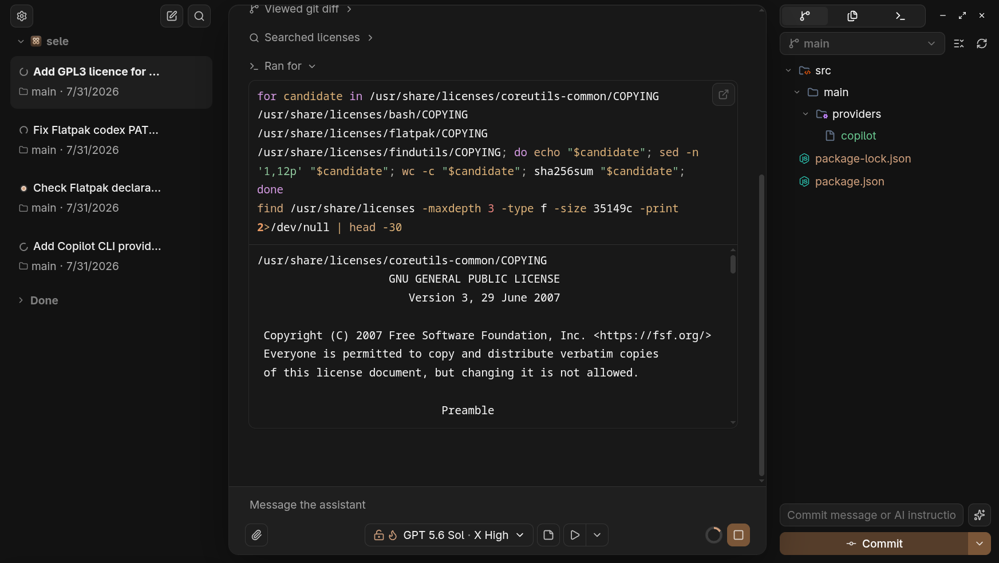

# Sele

A focused desktop workspace for working with AI coding agents across local projects.



Sele keeps conversations, project context, diffs, file editing, and terminal sessions together
in one desktop app. It supports OpenAI Codex, Anthropic Claude Code, GitHub Copilot, and
OpenCode.

[AI prompt suggestions](docs/prompt-suggestions.md) offer native Claude and Codex next-prompt
predictions in the composer. Press Tab to accept a suggestion or Escape to dismiss it.

## Install

Download the latest Windows, macOS, or Linux package from
[GitHub Releases](https://github.com/Chipi-Chapa-Corp/sele/releases).
Each platform has its own release entry and becomes available as soon as its build
finishes. Installed apps check their platform's releases independently.

Install the Linux Flatpak from Sele's update repository:

```bash
flatpak install --user https://chipi-chapa-corp.github.io/sele/flatpak/sele.flatpakref
```

The repository descriptor is also available as
[`sele.flatpakrepo`](https://chipi-chapa-corp.github.io/sele/flatpak/sele.flatpakrepo) and
as a downloadable asset on Linux GitHub Releases.
Use the `.flatpakref` for immediate installation and updates. The standalone `.flatpak`
download is attached later, once its installer compression finishes.

Install on macOS with Homebrew:

```bash
brew tap chipi-chapa-corp/sele https://github.com/Chipi-Chapa-Corp/sele.git
brew install --cask chipi-chapa-corp/sele/sele
```

Upgrade a Homebrew installation with:

```bash
brew update
brew upgrade --cask chipi-chapa-corp/sele/sele
```

The cask tracks numbered stable releases and verifies the DMG checksum. Direct DMG
downloads remain available for installations without Homebrew.

> [!IMPORTANT]
> macOS builds are currently unsigned. If Gatekeeper says Sele is damaged, corrupted, or
> cannot be opened, remove the download quarantine and start the app again:
>
> ```bash
> sudo xattr -dr com.apple.quarantine /Applications/Sele.app
> open /Applications/Sele.app
> ```

Sele uses the coding-agent CLIs, Git, and shell installed on your host system. Install and
authenticate the CLI you want to use before starting Sele.

```bash
codex --version
claude --version
copilot --version
opencode --version
```

Desktop process environments may not include the same `PATH` as your interactive terminal.
If Sele cannot find a provider, or the provider lookup resolves back to Sele and opens duplicate
windows, point Sele at the real provider executable explicitly. For Codex:

```bash
flatpak override --user --env=SELE_CODEX_PATH="$(command -v codex)" com.chipichapa.sele
launchctl setenv SELE_CODEX_PATH "$(command -v codex)"
```

If the Flatpak cannot see a host Copilot install, point Sele at that executable as well:

```bash
flatpak override --user --env=SELE_COPILOT_PATH="$(command -v copilot)" com.chipichapa.sele
```

Claude Code can be configured the same way when it is outside Sele's desktop `PATH`:

```bash
flatpak override --user --env=SELE_CLAUDE_PATH="$(command -v claude)" com.chipichapa.sele
launchctl setenv SELE_CLAUDE_PATH "$(command -v claude)"
```

OpenCode also supports an explicit executable path:

```bash
flatpak override --user --env=SELE_OPENCODE_PATH="$(command -v opencode)" com.chipichapa.sele
launchctl setenv SELE_OPENCODE_PATH "$(command -v opencode)"
```

Authenticate Claude Code with `claude auth login` before using the Claude provider.

With Claude Code 2.1.281 or newer, use **Settings → Providers → Claude → Accounts** to
add and switch subscription accounts on Linux, macOS, or Windows. Accounts share the
same local chats, settings, plugins, and memory. Sele selects only the credential store
using `CLAUDE_SECURESTORAGE_CONFIG_DIR`; Claude stores credentials in Keychain on macOS
and account-specific files elsewhere. **Default** uses your existing CLI authentication.
Adding an account leaves the current account selected until sign-in succeeds. Switching
stops running Claude turns in that environment; existing chats can then resume with the
selected account. If browser authorization returns a code, paste it into the account dialog.
Usage lookups use a separate per-account cache so Claude cannot reuse another account's
limits. This background lookup does not create chats or change the shared chat configuration.

Codex accounts also share native history across Linux, macOS, and Windows using
account-specific shadow homes. Existing saved accounts keep their credentials;
Codex handles sign-in and token refresh. Linux and macOS no longer need the
privileged account helper. On Windows, enable Developer Mode or allow symbolic
link creation. See [per-chat accounts](docs/per-chat-accounts.md).

For Copilot, start `copilot` once and use `/login` if the CLI is not already authenticated.

For OpenCode, connect at least one model provider with `opencode auth login`. Sele runs a
private, authenticated `opencode serve` process for each supported source. OpenCode works on
the host, in Sele's current container, and in Distrobox or Toolbox sources. Separately selected
remote SSH, Docker, and Podman sources are not currently exposed because their loopback server
is not safely reachable by Sele.

Sele supports **OpenCode 2 only**, shown as **OpenCode**. OpenCode 1 installations are ignored.
Install `@opencode/cli`, or set `SELE_OPENCODE_PATH` to an OpenCode 2 executable. Sele also
finds its managed installation and v2 binaries shadowed by an older `opencode` on `PATH`.

The new-chat composer stacks update suggestions for all installed providers in the selected
environment. OpenCode updates track the v2 CLI package. Existing migrated v2 profiles and
conversation history are retained; Sele exposes one OpenCode chat list. When preparing a
profile for the first time, Sele backs up settings and saved credentials and seeds a separate
database from existing OpenCode data. The original database is untouched. Existing
`OPENCODE_DB` overrides are respected. Custom v1 plugins need v2 implementations; expired
credentials or unsupported remote MCP OAuth credentials may require sign-in again.

## GitHub pull requests

Enable **Settings → Git → Features → Enable pull requests** (off by default), then
choose **Pull requests** in the Git sidebar to browse PRs for the project's GitHub remote.
Use the state selector to include open, merged, closed, and draft PRs. Search by title or
PR number below the filters. The list fetches a small window around your scroll position and renders only the
visible rows. Offscreen pages are discarded and fetched again when you scroll back. Reload refreshes the list. GitHub search makes the first 1,000 matching PRs available.

Use the globe button on a row to open a PR in Sele's browser, or the external-link button
to use your default browser. Open icons are green, merged purple, closed red, and drafts gray.

Install GitHub CLI (`gh`) and run `gh auth login` on the machine hosting the project,
including inside its container or SSH environment. Sele uses the GitHub `origin` remote,
then `upstream`, or the only remaining GitHub repository. This view currently supports github.com.

## Local network access

In **Settings → Local network**, enable **Allow local network access**. Open the
Android app on the same Wi-Fi, choose your computer, and approve its request in
desktop Sele. No connection link or code is needed. Nearby discovery advertises
only the computer’s identity and port; each approved device gets its own credential.
The advanced **Browser access links** section also supports a phone browser.
Keep Sele open and the computer awake. The default TCP port is **4589**; allow the
selected port through your computer's firewall if the phone cannot connect. Guest
Wi-Fi and access-point client isolation can prevent devices from reaching each other.

Access is off by default. A connection link grants control of the host's projects,
agents, files, Git, and terminals. HTTP and WebSocket traffic is unencrypted, so use
this mode only on a trusted local network and do not forward its port to the internet.
**Remove device** immediately revokes that device, including saved access after
restart. **Reset connection links** revokes browser links independently of paired
Android devices. Turning access off stops the server and discovery. Settings and
approved devices persist across restarts.

Phone layout, selections, and drafts stay on the client, separately for each computer. Conversations and
agent execution remain on the computer. A disconnected client reconnects and reloads
current state; it never automatically retries a send or other mutation. Check the
conversation before resending a request whose connection was lost.

Mobile opens on the conversation, with a slide-out sidebar for chats, New Chat, search,
accounts, and settings. Goal, notes, actions, limits, and on-reset live in the chat’s tools menu.
Swipe right to open the sidebar and left to close it; workspace tools
open from the compact conversation header. The existing large-screen layout is preserved.
Hold a chat to reveal its actions. Sleeping chats and wake timers sync with desktop,
including sleeps saved before the phone connects. Phone file editing uses a native text area
with the same save, diff, and review model; desktop editing keeps Monaco. Terminals include
touch shortcuts for Escape, Tab, interruption, and command history. The Browser tab shows
and controls the computer’s browser, including live desktop changes. Folder and identity-file
pickers browse the host, while attachments upload from the phone. Downloads and diagnostic
logs use Android’s Save dialog.

Desktop automation, interactive MCP widgets, and archive import/export remain desktop
features. Phone terminal sessions close on disconnect; agent-owned processes remain on the host.
See [mobile development and testing](docs/mobile.md) for architecture and emulator checks.
For development, `npm run dev` proxies the existing Vite renderer through the LAN
server; reload the phone page after source changes. Packaged builds serve bundled assets.

## Android APK

Build an installable Android debug APK with **JDK 21**, **Android SDK platform 36**,
and **Android SDK Build-Tools 35.0.0** installed:

```bash
npm install
# Set JAVA_HOME to JDK 21 and ANDROID_HOME to your Android SDK directory.
npm run build:android
```

The APK and SHA-256 checksum are written to
`dist/sele-<version>-android-debug.apk` and the adjacent `.sha256` file. This is a
debug-signed APK for local installation, not a Play Store release. Android 7 or newer
is required. When building in a container whose cgroup warnings break Java tool
version detection, set `JAVA_TOOL_OPTIONS=-XX:-UseContainerSupport` for the build.

Install the APK, enable **Settings → Local network** in desktop Sele, choose your
computer in the Android app, and approve the request on your computer. The app
bundles the shared UI; only the authenticated WebSocket connects to your computer.
The approved connection and per-host drafts use Android’s private durable storage. Keep both devices on the same trusted LAN, Sele open, and the computer
awake. Restart the updated desktop app before pairing the APK.

Use **Settings → Local network → Connect to another computer** in the Android app
to change hosts. Drafts and UI preferences stay separate for each host. The desktop
features and limitations listed above also apply to Android.

`npm run build:mobile:web` builds the shared renderer; `npm run sync:android` also
copies it into the native project. No hosted server URL is embedded in the APK.

## Development

See the [repository guide](docs/README.md) for the code layout and focused
implementation notes.

Requires Node.js 22.

PR mock data lives in `scripts/tests/fixtures/githubPullRequests.ts` and is injected
through the test harness API. Run `SELE_TEST_PR_MOCKS=1 npm run test:ui -- github-pull-requests`
to check scrolling, filtering, and cache eviction against 100 fixture PRs. The app
always loads pull requests through its normal GitHub API.

```bash
npm install
npm run dev
```

Renderer edits use React Fast Refresh. Compatible component and helper edits retain
UI state, and updates reaching the renderer entry reuse the mounted React root and
replace its listeners. Changing hook order or component identity can still reset
the affected component. Refresh tracks signatures in custom `.ts` and hook-only `.tsx`
modules so hook additions remount their consumers safely. Main-process and preload changes require a restart or reload.
Restart `npm run dev` after changing `electron.vite.config.ts`, `vite.renderer.ts`, or its
plugins. Reloading the window alone keeps the running server's dependency configuration.
`npm run test:ui -- renderer-hmr` checks drafts, selection, focus, and scrolling across real
Vite updates; run this GUI fixture on the `isolated-gui` private display.

Run the project checks with:

```bash
npm run check
npm run build
```

`npm install` / `npm ci` installs the repository's Git pre-commit hook through
`npm run prepare`. The hook runs `npm run check`: lint, type-checking, unit tests,
and integration tests, matching CI validation. A failed check blocks the commit.
For an existing checkout, run `npm run prepare` once to enable the hook.

Use these test entry points:

| Command | Coverage |
| --- | --- |
| `npm test` | All source `*.test.mjs` regressions; no GUI or installed provider CLI required |
| `npm run test:integration` | Native SQLite, bundling and dependency checks; no GUI |
| `npm run test:ui` | Electron and renderer fixtures; private display required on Linux |
| `npm run test:runtime` | Installed Codex handoff and built Claude discovery worker; requires CLIs / `npm run build` |
| `npm run test:native` | Linux GTK input/capture fixture; private display required |
| `npm run test:e2e` | Full app and provider transport scenarios |
| `npm run test:mobile-providers` | Android emulator and provider transport scenarios |
| `npm run test:clean` | Remove generated test results, benchmark results and coverage |

Unit, integration, UI, runtime and native commands accept case-insensitive file-path
filters (multiple filters match either) and `--list` to inspect selection without
running tests. For example, `npm test -- appUpdate`,
`npm test -- providers/copilot/`, and `npm run test:ui -- composer-input`.
An unmatched filter fails instead of silently passing. New source tests and `test-*`
fixture drivers are discovered automatically; helpers and fixtures are never run as
tests. Unit files run with four workers and a 30-second timeout per file. Fixture
drivers run sequentially and report every failed file.

Linux GUI suites require the `isolated-gui` helper's private display and D-Bus session.
For this development environment:

```bash
desktop=/var/home/kitkat/.codex/skills/isolated-gui/scripts/desktop.py
python3 "$desktop" --session sele-tests start
python3 "$desktop" --session sele-tests run --cwd "$PWD" --timeout 180 -- \
  npm run test:ui -- input-focus
python3 "$desktop" --session sele-tests stop
```

Run `npm run build` before `test:ui -- preferences` or `test:runtime -- claude-discovery`.
Device-dependent Android helpers remain opt-in through the local-access and mobile
provider fixtures; they are not part of the default suites.

Regression tests live beside their source; Electron and worker fixtures live in
`scripts/tests/`. The native database cases share `test-database.cjs`; to select a
single case, use `node scripts/tests/test-database.cjs sqlite-worker`.
Keep behavioral coverage when consolidating tests, and reuse shared fixtures and setup.
Use unit tests for error propagation and logging behavior; keep syntax rules in the linter.

`npm run test:e2e` builds Sele and drives the real app against the installed Codex,
Claude Code, Copilot and OpenCode CLIs. A local scripted model server answers for every
provider, and all provider homes, the Sele profile and its database are temporary, so no
account is used. It opens windows; run it on a private display such as Xvfb. Options:
`--provider codex,claude`, `--phase messaging,navigation,transcripts`, `--only <name>`,
`--skip-build` and `--keep`; `SELE_E2E_LONG_TURNS` sets the long-transcript length and
`SELE_E2E_BUDGET_SCALE` relaxes latency and frame budgets on slow machines. Reports and
failure screenshots go to `test-results/e2e/`.

Performance commands use the `benchmark:*` prefix. Reusable performance benchmarks live in `scripts/benchmarks/`. Keep generated
reports, screenshots, and profiling output in the gitignored `test-results/` or
`benchmark-results/` directories, and use `tmp/` for local scratch files. The
`build/` directory contains required packaging assets, not generated output.

Linting uses [Biome](https://biomejs.dev/guides/migrate-eslint-prettier/) with rules migrated
from the previous ESLint configuration. `npm run lint:fix` applies safe lint fixes;
`npm run format` formats supported source files using two spaces, single quotes,
optional semicolons, and a 100-column line width. Formatting is separate from linting.
Markdown and YAML are no longer formatted by this command. Install the recommended
Biome VS Code extension for editor diagnostics and formatting.

The migration preserves the named-export rule and existing hook-dependency exemptions.
Biome does not cover every previous rule (including React Compiler/Refresh checks and
explicit function return types). Three migrated rules are disabled because their behavior
differs: empty blocks also flags intentional no-op functions and catches; prototype-builtins
flags existing `Object.prototype.hasOwnProperty.call` checks; restricted-name shadowing
also flags local `escape` and `hasOwnProperty` helpers. TypeScript checks remain separate
and required. Existing hook-dependency warnings are reported without failing lint.

## License

[GNU General Public License v3.0 only](LICENSE)

### Diagnostic logs

To report a technical issue, open Settings and select **Logs**. Attach the saved
`.log` file to your issue. It includes timestamps, app/runtime versions, main-process and app-interface
warnings and errors, failed IPC requests, and unexpected process exits. Logs stay on your device;
exporting saves a local copy and does not upload it. Review the file before sharing, since error
messages can include file paths and other details from your environment.

Sele keeps `sele.log` and one rotated `sele.log.1`, up to 5 MiB each, across restarts. The export
combines both files, oldest first. Oversized individual messages are truncated. The log directory is
`~/Library/Logs/sele` on macOS and `logs` within Electron's app user-data directory on Windows/Linux
(normally `%APPDATA%/sele/logs` or `~/.config/sele/logs`; sandboxed packages can use a different root).
Third-party pages in browser tabs are excluded from app console logging.
