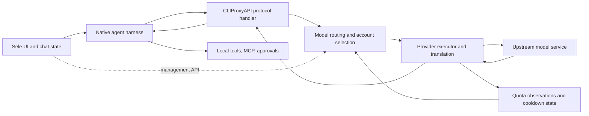

# CLIProxyAPI, alternatives, and a Sele integration assessment

Research date: 2026-10-24. This is a source and documentation audit, not a live inference or authentication test. No accounts were connected and no application was launched. Recommendations below are engineering judgments based on that audit.

## Decision

CLIProxyAPI can supply model-request routing, subscription authentication, account pools, failover, and protocol conversion. It can be supported by Sele and can be packaged as a managed sidecar. It does not replace Sele's agent runtimes or implement durable continuation of a stopped chat.

For Sele's immediate requirements, extend the existing native account system: account selection already exists for Codex and Claude, but **Sele's native Codex multi-account isolation currently requires a Linux execution environment**. macOS/Windows parity remains work to do. Add an explicit automatic-account policy and a durable quota-wait/resume controller. In parallel, an optional gateway is a practical route to cross-platform inference-account switching: initially support OpenCode and Copilot's custom-provider path, followed by explicit Codex and Claude configurations. Bundle a pinned proxy only after those paths are verified.

Use upstream CLIProxyAPI as the default gateway candidate. Evaluate a selected plugin or the Plus fork when a required upstream is missing. CCS and CC Switch are useful implementation references for account/configuration UX; 9Router and OmniRoute are broader gateway alternatives; LiteLLM is more relevant to API-key and organizational routing.

## Versions and evidence

| Project | Evidence inspected |
| --- | --- |
| CLIProxyAPI | Current source at [`8289ec4c71ad914d0612c2776352b76ba3d355a6`](https://github.com/router-for-me/CLIProxyAPI/tree/8289ec4c71ad914d0612c2776352b76ba3d355a6), dated October 24; latest published release observed was [v8.0.41](https://github.com/router-for-me/CLIProxyAPI/releases/tag/v8.0.41), published October 23. Main may contain changes newer than that release. |
| CLIProxyAPI Plus | The concrete fork audited is [`jc01rho/CLIProxyAPIPlus`, commit `c3ac5e610a4f181619dc04177a92791c671746ca`](https://github.com/jc01rho/CLIProxyAPIPlus/tree/c3ac5e610a4f181619dc04177a92791c671746ca); latest release observed was v8.0.41-1. Different repositories use the Plus name and do not necessarily have the same provider set. |
| Plugins | The official-store [registry](https://github.com/router-for-me/CLIProxyAPI-Plugins-Store/blob/main/registry.json), plus selected plugin READMEs. Registry listing establishes advertised availability, not that each plugin works with every host release. |
| Alternatives | Maintainer documentation and READMEs linked in the comparison below. Their advertised capabilities were not exercised. |
| Sele | The current working tree, including its existing uncommitted per-chat account work. Findings describe that working tree, not necessarily a released Sele build. |

Older CLIProxyAPI guides are materially different. Current configuration uses `config-version: 8` and nested sections; `/v0/management` remains available alongside `/v8/management`. The SDK guide still contains v6 imports and an `internal/config` import; current code exposes public `sdk/config` and uses module `/v8`. Do not copy that example unchanged. [Current management contract](https://github.com/router-for-me/CLIProxyAPI/blob/8289ec4c71ad914d0612c2776352b76ba3d355a6/docs/management-api-v8.md), [public configuration API](https://github.com/router-for-me/CLIProxyAPI/blob/8289ec4c71ad914d0612c2776352b76ba3d355a6/sdk/config/config.go).

## 1. CLIProxyAPI feature inventory

This inventory covers product capabilities found in the current core, its configuration, SDK, and selected extensions. Provider-specific fixes and every possible third-party plugin are outside the definition of a core feature.

### Client protocols and model execution

| Capability | Current behavior |
| --- | --- |
| OpenAI interfaces | Chat Completions, legacy Completions, Responses, and Responses compaction. |
| Anthropic interfaces | Messages and token counting. |
| Google interfaces | Gemini model listing/generation and Interactions. |
| Streaming | SSE and buffered responses; Responses WebSockets and provider-specific WebSocket execution. This is not blanket WebSocket support for every provider. |
| Model catalog | Client-facing discovery, provider capabilities, aliases, prefixes, exclusions, context-window overrides, and refreshable catalogs. |
| Tools | Function/tool translation, tool-result conversion, and provider-specific handling of reasoning/signatures and tool search. The harness still executes its tools. |
| Multimodal | Text/image input; image generation/editing; video creation/retrieval and provider-specific editing/extension; speech/TTS and Codex live/realtime routes. Availability depends on the selected upstream. |

Evidence: [inbound route registration](https://github.com/router-for-me/CLIProxyAPI/blob/8289ec4c71ad914d0612c2776352b76ba3d355a6/internal/api/server_routes.go), [translators](https://github.com/router-for-me/CLIProxyAPI/tree/8289ec4c71ad914d0612c2776352b76ba3d355a6/internal/translator), [model configuration](https://github.com/router-for-me/CLIProxyAPI/tree/8289ec4c71ad914d0612c2776352b76ba3d355a6/internal/modelconfig), [provider executors](https://github.com/router-for-me/CLIProxyAPI/tree/8289ec4c71ad914d0612c2776352b76ba3d355a6/internal/runtime/executor).

### Accounts, routing, and recovery

| Capability | Current behavior |
| --- | --- |
| Multiple accounts | Multiple credentials can serve a provider/model pool concurrently. |
| Selection strategies | Round robin, weighted round robin, and fill first. Fill first keeps consuming one available account before moving on. Weights are configured values, not automatically calculated from remaining quota. |
| Priorities | Higher credential priority influences initial selection and fallback; priority and weight have different meanings. |
| Sticky sessions | Optional session affinity with a TTL; recognizes explicit Claude, Codex, OpenCode, and Pi session identities and several fallback identities. An established healthy binding can outrank a recovered higher-priority account. |
| Subagent affinity | Optional inheritance of the parent's account, including special guardian-review handling. Can instead distribute child sessions for concurrency. |
| Failure policy | Configurable rebinding on any credential failure, or retaining the original binding through transient failures while rebinding on quota/auth failures. |
| Failover | Tries another eligible credential after supported failures; eligibility includes model availability, disablement, cooldown, and routing policy. |
| Retry budgets | Additional retry rounds, a maximum number of credentials tried per round, and a bounded cooldown wait. Global, provider, and credential overrides exist. |
| Quota cooldown | Records account/model unavailability and recovery timing; honors provider retry signals and provider-specific quota parsing. Accounts become eligible after cooldown expiry. |
| Model-scoped cooldown | Opt-in Codex/Claude settings can scope quota cooldown to a model rather than all sibling models on the credential. Correct scope depends on the real provider limit. |
| Cooldown persistence | Optional persistence beside credential files; otherwise cooldown scheduling state is in memory. |
| Error classification | Custom rules can stop, continue, cool down, or combine those actions based on status and body patterns. |
| Stream bootstrap recovery | Retry before downstream output is committed; extra Codex bootstrap buffering is optional. Accepted full-duplex input is not blindly replayed. |
| Token maintenance | Background OAuth refresh, manual refresh, provider-specific refresh handling, and Sign in with ChatGPT binding for eligible file-backed Codex credentials. |
| Model fallback pools | Configured alias pools can distribute requests among upstream model names and try another member on an early failure. This is a configured fallback mechanism, not an automatic guarantee of equivalent models. |

Evidence: [selectors](https://github.com/router-for-me/CLIProxyAPI/blob/8289ec4c71ad914d0612c2776352b76ba3d355a6/sdk/cliproxy/auth/selector.go), [session handling](https://github.com/router-for-me/CLIProxyAPI/tree/8289ec4c71ad914d0612c2776352b76ba3d355a6/sdk/cliproxy/session), [selection/retries](https://github.com/router-for-me/CLIProxyAPI/blob/8289ec4c71ad914d0612c2776352b76ba3d355a6/sdk/cliproxy/auth/conductor_selection.go), [cooldown implementation](https://github.com/router-for-me/CLIProxyAPI/blob/8289ec4c71ad914d0612c2776352b76ba3d355a6/sdk/cliproxy/auth/conductor_cooldown.go), [stream execution](https://github.com/router-for-me/CLIProxyAPI/blob/8289ec4c71ad914d0612c2776352b76ba3d355a6/sdk/cliproxy/auth/conductor_stream.go), [refresh loop](https://github.com/router-for-me/CLIProxyAPI/blob/8289ec4c71ad914d0612c2776352b76ba3d355a6/sdk/cliproxy/auth/auto_refresh_loop.go).

Two important qualifications: selection ordinarily reacts to availability/cooldown rather than continuously optimizing every account's remaining subscription allowance; and OAuth token refresh renews credentials, not the subscription quota.

### Configuration, operation, and extensibility

The gateway provides separate client API keys and management authentication; credential upload/list/download/update/delete; OAuth start/callback/status/cancel operations; authenticated upstream API calls; credential model/status inspection; recent request and cooldown information; log access; usage event delivery; a terminal management UI; and a separately maintained web panel. Current v8 plugin quota routes expose a normalized extension contract. They do not promise working quota lookup for every provider out of the box. [Management endpoints](https://github.com/router-for-me/CLIProxyAPI/blob/8289ec4c71ad914d0612c2776352b76ba3d355a6/docs/management-api-v8.md), [credential summaries](https://github.com/router-for-me/CLIProxyAPI/blob/8289ec4c71ad914d0612c2776352b76ba3d355a6/internal/api/handlers/management/auth_files.go).

Request controls include global/per-credential HTTP or SOCKS proxies, headers, payload defaults/overrides/filters, thinking parameters, header passthrough, keepalives, and provider compatibility switches. Deployment controls include listener/TLS settings, request-body bounds, trusted proxies, optional LAN discovery, rotating/request logs, profiling, and a lower-overhead operating mode. Configuration and credential changes can reload without rebuilding the server. [Configuration reference](https://github.com/router-for-me/CLIProxyAPI/blob/8289ec4c71ad914d0612c2776352b76ba3d355a6/config.example.yaml), [watcher](https://github.com/router-for-me/CLIProxyAPI/tree/8289ec4c71ad914d0612c2776352b76ba3d355a6/internal/watcher).

There are file-backed credentials and optional Git, PostgreSQL, and object-storage implementations. Home mode delegates configuration and account scheduling/concurrency to a remote control plane and disables local management; it is a different operational mode, not required for a desktop sidecar. [Storage code](https://github.com/router-for-me/CLIProxyAPI/tree/8289ec4c71ad914d0612c2776352b76ba3d355a6/internal/store), [Home code](https://github.com/router-for-me/CLIProxyAPI/tree/8289ec4c71ad914d0612c2776352b76ba3d355a6/internal/home).

The Go SDK permits embedding and custom executors/translators. Native dynamic-library plugins can add authentication, providers, scheduling, routing, request/response processing, thinking, quota/usage handling, CLI flags, management APIs, and UI resources. Plugins execute trusted code in the proxy process and need matching platform builds. They are disabled by default. [Plugin API](https://github.com/router-for-me/CLIProxyAPI/tree/8289ec4c71ad914d0612c2776352b76ba3d355a6/sdk/pluginapi), [examples](https://github.com/router-for-me/CLIProxyAPI/tree/8289ec4c71ad914d0612c2776352b76ba3d355a6/examples/plugin).

### Features that need an extension or another application

| Extension/project | Useful addition | Boundary |
| --- | --- | --- |
| [kpatdev Quota Router](https://github.com/kpatdev/quota-router) | Claude/Codex quota-aware policies: reset-first, quota-pressure, balanced; quota polling and passive observations; session/subagent affinity; dashboard and differentiated failover. | An account scheduler. It does not resume Sele chats. Reads five-hour, weekly, monthly, and model windows where available. |
| [Expiring Quota First](https://github.com/stavarengo/CLIProxyAPI-Expiring-Quota-First) | Choose new Claude/Codex sessions by earliest weekly reset; persistent sticky sessions; passive quota observation. | Its documented policy ignores five-hour limits. Less suitable if short-window exhaustion is the main concern. |
| [Codex Quota Scheduler](https://github.com/JefferyZhang2019/cpa-plugin-codex-quota-scheduler) | Codex-specific quota pressure/fill-first ordering, refresh and response observations, circuit state, reset handling. | Optional reset-window activation sends a small model request and may consume allowance. That starts a provider window; it does not continue an agent task. |
| [Provider Rate Limiter](https://github.com/lsmallice/cliproxyapi-provider-rate-limiter-plugin) | Per-account sliding-window request admission with provider/default RPM settings. Returns retryable 429 if all candidates are over limit. | Counts admitted attempts, including failures; provider defaults apply separately to accounts, not as one aggregate cap. In-memory windows are single-process. Host-version compatibility needs verification. |
| [CPA Quota](https://github.com/tom2almighty/cpa-quota) | Normalized subscription/windows/reset information for Claude, Codex, Antigravity, Kimi, xAI, Devin, and Meta. | Separate plugin; README declares AGPL-3.0, so do not assume core's MIT license covers it. |
| Usage Keeper / manager dashboards | Persistent request history, token/cost analytics, charts and account operations. | Separate services/plugins. The upstream README says built-in usage statistics were removed in v6.10.0; current event delivery/configuration remnants should not be mistaken for a complete historical analytics store. [Upstream usage guidance](https://github.com/router-for-me/CLIProxyAPI#usage-statistics). |

The store also advertises pacing, key-to-account binding, quota notifications, account tiers, and reset-window starters. These are candidates for evaluation, not core guarantees. [Complete current registry](https://github.com/router-for-me/CLIProxyAPI-Plugins-Store/blob/main/registry.json).

## 2. Supported harnesses and upstream accounts

“Supports Codex” has two different meanings: a Codex account can supply inference, or the Codex harness can send inference through the proxy. Neither means the proxy implements Codex's session/tool/approval API. Keep these inventories separate.

### Downstream harnesses: current core documentation

The complete current **Agent Client Configuration** navigation contains six harnesses:

| Harness | Integration surface |
| --- | --- |
| [Claude Code](https://help.router-for.me/agent-client/claude-code) | Anthropic base URL/token and gateway model discovery. |
| [Codex CLI / Codex App](https://help.router-for.me/agent-client/codex) | Custom model-provider configuration using Responses; OAuth-compatible and API-key modes; optional WebSocket and live endpoints. |
| [Factory Droid](https://help.router-for.me/agent-client/droid) | Custom model/provider definitions. |
| [OpenCode](https://help.router-for.me/agent-client/opencode) | Provider configuration aimed at the local endpoint. |
| [Grok Build](https://help.router-for.me/agent-client/grok-build) | Custom provider/model configuration. |
| [Pi](https://help.router-for.me/agent-client/pi) | Provider extension/configuration. |

This is the documented finite list, not a closed interoperability whitelist. An HTTP client implementing a supported protocol and allowing a custom endpoint may also work. Its tool schema, reasoning, compaction, streaming, and session behavior still need validation.

### Downstream harnesses: official desktop wrapper

[EasyCLIProxyAPI](https://github.com/router-for-me/EasyCLIProxyAPI#agent-client-configuration) advertises configuration support for **Claude Code, Claude Desktop, Codex, OpenCode, OpenClaw, Hermes Agent, Pi, ZCode, WorkBuddy / WorkBuddy AI, Antigravity CLI, Kimi Code, Grok Build, and Oh My Pi**. Pi uses an extension; Antigravity CLI needs launch-time endpoint/key environment. This wrapper's client-configuration support is additional to core's six guides.

Hermes also has a [dedicated provider plugin](https://hermes-agent.nousresearch.com/docs/plugins/cliproxyapi-provider) that selects the appropriate wire format and can read live model capabilities.

Older README copies advertise special Amp support. The audited current core lacks the previous Amp integration module and current documentation does not list Amp. Treat that historical claim as unverified for v8, rather than promising a working Amp integration. Likewise, Gemini CLI as an upstream account is different from implementing all native Gemini CLI inbound endpoints.

### Upstream accounts/providers: core

| Upstream family | Inspected support |
| --- | --- |
| OpenAI / Codex | OAuth browser/device login, API-key routes, HTTP/Responses WebSockets, eligible SIWC binding. |
| Anthropic / Claude | Claude OAuth and Anthropic-compatible API-key routes. |
| Google Antigravity | OAuth account/executor. |
| Google Gemini API | API-key executor, including Interactions. |
| Google Vertex | API-key/service-account paths and import. |
| Google AI Studio | AI Studio executor/relay channel. |
| Kimi | Kimi.com and Kimi.ai OAuth plus compatible API access. These are aliases/regions within the Kimi executor family. |
| xAI / Grok | OAuth/API-key support and HTTP/WebSocket/media paths where available. |
| Devin | OAuth and dedicated execution. |
| Meta / Muse | Meta login and dedicated execution/API access. |
| Custom compatible providers | Configured OpenAI-compatible endpoints and native-compatible API-key groups; e.g. a relay or local serving endpoint. There is no finite vendor list here. |

Evidence: [executor registration](https://github.com/router-for-me/CLIProxyAPI/blob/8289ec4c71ad914d0612c2776352b76ba3d355a6/sdk/cliproxy/service_executors.go), [CLI login flags](https://github.com/router-for-me/CLIProxyAPI/blob/8289ec4c71ad914d0612c2776352b76ba3d355a6/cmd/server/main.go), [authentication implementations](https://github.com/router-for-me/CLIProxyAPI/tree/8289ec4c71ad914d0612c2776352b76ba3d355a6/internal/auth).

Core's current CLI has no built-in Gemini CLI Google-login flag. The official [Gemini CLI provider plugin](https://github.com/router-for-me/cpa-plugin-gemini-cli) adds `--geminicli-login`, credential parsing, refresh, project handling, and upstream Cloud Code translation. It explicitly does **not** restore native inbound `/v1internal:generateContent` or `/v1internal:streamGenerateContent` routes.

### Upstream accounts/providers: Plus and plugins

In addition to shared upstream families, the audited **jc01rho Plus** tree has dedicated execution/registration paths for **Gemini CLI, GitHub Copilot, Cursor, Kiro, iFlow, Cline, Kilo/Kilo Gateway, Alysis, ZCode, WorkBuddy, CommandCode, Freebuff/Codebuff, OpenCode Zen/Go, and Mimocode**. CodeBuddy has dedicated auth/executor source as well. GitLab Duo has auth and executor modules and its own guide; Mistral has dedicated executor source plus compatibility handling. These are source-presence findings, not a claim that every upstream account is currently accepted. Qwen Code was not found as a dedicated OAuth implementation in this snapshot. [Plus executors](https://github.com/jc01rho/CLIProxyAPIPlus/tree/c3ac5e610a4f181619dc04177a92791c671746ca/internal/runtime/executor), [auth modules](https://github.com/jc01rho/CLIProxyAPIPlus/tree/c3ac5e610a4f181619dc04177a92791c671746ca/internal/auth), [registration](https://github.com/jc01rho/CLIProxyAPIPlus/blob/c3ac5e610a4f181619dc04177a92791c671746ca/sdk/cliproxy/service_executors.go).

The official-store registry also lists provider plugins for **Gemini CLI, Copilot, Cursor, Kiro, ZCode, WorkBuddy/CodeBuddy International, Cline Pass, CommandCode, OpenCode Go/Zen, DeepSeek, Kimi tools, Vertex ADC, additional OpenAI OAuth, Google Flow, Groq Whisper, Mirasim, and other custom/free-model relays**. A multi-provider plugin advertises **Qoder, Trae/Solo, CodeArts, and MiniMax Code** alongside some of those families. These are community extensions with their own licenses, artifacts and support levels. Prefer discovering installed capabilities over hardcoding a claim that all are part of upstream. [Registry source](https://github.com/router-for-me/CLIProxyAPI-Plugins-Store/blob/main/registry.json).

## 3. Alternatives

| Project | Relevant feature set | Fit for Sele |
| --- | --- | --- |
| [CLIProxyAPI Plus](https://github.com/jc01rho/CLIProxyAPIPlus) | Core architecture plus additional subscriptions/providers and provider-specific translation/fallback fixes. | Strong candidate when a specific extra provider is required. More upstream adapters also mean more maintenance and regressions to track. Pin the actual fork. |
| [9Router](https://github.com/decolua/9router) | Node/Next.js gateway and dashboard; account pools; round-robin/priority routing; quota fallback; OAuth refresh; named multi-provider combos; protocol translation; quotas/reset countdowns; logs, SQLite analytics, cloud sync, and optional context/output compression. | Convenient ecosystem and JS stack; broader application/runtime surface than a Go sidecar. Compression alters model input/output and needs independent evaluation for coding fidelity. |
| [OmniRoute](https://github.com/cheaper-inference/OmniRoute) | TypeScript/Next.js gateway; automatic and custom combos, many routing strategies, quota-aware fallback, provider circuit breakers, account cooldowns and model lockouts; analytics; multimodal routes; compression/cache; MCP/A2A and several deployment/UI options. | Consider as an external gateway for advanced routing. Advertised provider/model counts describe its catalog, not fully tested account integrations. Larger scope than Sele's immediate account requirements. |
| [CCS](https://github.com/kaitranntt/ccs) | Profile/runtime manager; isolated Claude accounts; Claude/Codex/Droid launch flows; OAuth and API/local profiles; managed CLIProxy runtime; local Anthropic-to-OpenAI bridge; dashboard, usage/health and tooling/fallback controls. | Good reference for isolated profile and runtime management. It uses CLIProxy technology, so is not an independent replacement for that layer. |
| [CC Switch](https://github.com/farion1231/cc-switch) | Cross-platform desktop config/account manager; provider presets; per-tool local routing and protocol conversion; failover queues/circuit breaker; aggregation; usage/costs; projects, sessions, MCP, skills, prompts and tray controls. | Good configuration/UX reference. Much of its scope overlaps Sele; do not embed an entire second desktop application merely to obtain account routing. |
| [Claude Code Router](https://github.com/musistudio/claude-code-router) | Current project includes desktop/CLI gateway, agent profiles, credential pools, model discovery, rule-based routing, retries/ordered fallback, client-key limits, detailed request/agent observation and extensions. | Worth evaluating for configurable routing and request shaping. Its current scope is wider than its original Claude-only reputation. |
| [LiteLLM](https://docs.litellm.ai/docs/routing) | API gateway/router; load balancing; retries, cooldowns and fallbacks; RPM/TPM-aware routing; organizational key, budget and observation features. | Stronger fit for paid API/provider infrastructure than reusing desktop subscription identities. Do not assume its API-key routing is equivalent to a Codex/Claude subscription account manager. |
| [EasyCLIProxyAPI](https://github.com/router-for-me/EasyCLIProxyAPI) | Official desktop management wrapper with core lifecycle/version management, OAuth, quota/plugin UI, usage history, aliases and agent configuration. | Best direct reference for shipping/supervising CLIProxyAPI in a desktop product. It is a wrapper around the same core. |

None of the audited documentation establishes a general mechanism that persists and resumes a **Sele** task after a long quota outage. Account re-eligibility, cooldown recovery, token renewal, window activation, and agent continuation are separate operations.

### Advertised downstream harness sets in alternatives

These lists are configuration/compatibility claims from their current maintainers, not Sele-certified integrations:

| Project | Named tools |
| --- | --- |
| [9Router main README](https://github.com/decolua/9router#-supported-cli-tools) | Claude Code, OpenClaw, Codex, OpenCode, Cursor, Antigravity, Cline, Continue, Droid, Roo, Copilot, Kilo Code, OpenDesign, jcode, Grok Build, Devin CLI, DeepSeek TUI, Qwen Code. Its separate [CLI README](https://github.com/decolua/9router/blob/master/cli/README.md) additionally names Gemini CLI, iFlow, Crush, Crusher and Aider. The lists are not perfectly synchronized. |
| [OmniRoute README](https://github.com/cheaper-inference/OmniRoute#-compatible-clis--coding-agents) | Claude Code, Codex CLI, Cline, Kilo Code, Zoo Code, Continue, Aider, ForgeCode, jcode, DeepSeek TUI, CodeWhale, OpenCode, Factory Droid, Copilot CLI, Cursor CLI, Smelt, Pi, Grok Build, Hermes Agent, OpenClaw, Goose, Open Interpreter, Warp AI, deyin.ai. Generic compatible-client support is also advertised. |
| [CCS](https://github.com/kaitranntt/ccs#why-ccs) | Claude Code, Codex CLI, Factory Droid runtime flows. Provider profile names such as GLM, Kimi or Ollama are not additional harnesses. |
| [CC Switch feature matrix](https://github.com/farion1231/cc-switch#supported-features-by-tool) | Claude Code, Claude Desktop, Codex, Gemini CLI, Grok Build, OpenCode, OpenClaw, Hermes, Pi, MiniMax Code, Kimi Code, Oh My Pi. Local routing is provided for Claude Code, Codex, Gemini CLI and Grok Build, plus Claude Desktop model mapping; other tools mainly use native/coexisting configurations. |
| [Claude Code Router](https://github.com/musistudio/claude-code-router#core-capabilities) | Claude Code, Claude Design, Codex, Grok CLI, Kimi CLI, Kilo Code, OpenCode, Pi, ZCode, WorkBuddy, and compatible API clients. |
| LiteLLM | Protocol/provider integration is open-ended; its routing documentation does not define a closed harness whitelist. |

## 4. How CLIProxyAPI works and where the code lives



1. The harness sends its normal model request to a configured local URL. Sele continues to speak the harness's session API, such as Codex app-server.
2. The protocol handler determines the model and request form. Aliases/prefixes and the model registry resolve the route.
3. The account manager filters candidates, applies priority/strategy/affinity or a scheduler plugin, and selects a credential. An SDK can pin an auth identity internally; do not assume the public inference API exposes arbitrary per-request account selection.
4. The executor obtains/refreshed credentials as needed, translates the payload, applies provider compatibility rules, and calls the upstream. Ordinary inference is implemented as network adapters rather than spawning a native CLI for every completion.
5. Responses are translated back and streamed to the harness. Tools advertised in the request are still run by the harness/Sele, except provider-hosted tools.
6. Results update quota observations, cooldown/availability and usage events. Eligible failures can cause another attempt before output is committed. Later requests can use recovered accounts.

Source map for the audited core:

```text
cmd/server/                  executable flags, bootstrap, storage/Home/TUI modes
internal/cmd/                provider login/import commands
internal/api/                HTTP server, routes, middleware, management API
sdk/api/handlers/            public protocol handlers, execution helpers
sdk/cliproxy/               service builder, lifecycle, executor/model registration
sdk/cliproxy/auth/          account manager, selection, retries, cooldown, refresh
sdk/cliproxy/session/       session identity and continuity support
internal/auth/             provider authentication and token formats
internal/runtime/executor/ provider request execution and compatibility behavior
internal/translator/       protocol request/response/stream translations
internal/thinking/         reasoning/thinking parameter handling
internal/registry/         model catalog and availability
internal/watcher/          configuration/credential hot reload
internal/store/            optional remote persistence implementations
internal/pluginhost/       native plugin loading and host callbacks
internal/pluginstore/      registry discovery and installation
sdk/pluginapi/, pluginabi/ plugin contracts
internal/home/             remote control-plane integration
internal/tui/              terminal management client
sdk/cliproxy/usage/         usage event interfaces/delivery
docs/, examples/           management/SDK references and extension examples
```

Evidence: [repository tree](https://github.com/router-for-me/CLIProxyAPI/tree/8289ec4c71ad914d0612c2776352b76ba3d355a6), [service wiring](https://github.com/router-for-me/CLIProxyAPI/tree/8289ec4c71ad914d0612c2776352b76ba3d355a6/sdk/cliproxy), [execution pipeline](https://github.com/router-for-me/CLIProxyAPI/tree/8289ec4c71ad914d0612c2776352b76ba3d355a6/sdk/cliproxy/pipeline).

## 5. Match to Sele's requested capabilities

| Requirement | CLIProxyAPI contribution | Sele responsibility |
| --- | --- | --- |
| Manual account switching | Credential pools and management controls. | Native Codex/Claude chat switching already exists, but Codex isolation requires a Linux execution environment. A gateway pool is a separate account choice and must not silently replace a pinned native account. |
| Automatic switch at a limit | Select another eligible credential, record cooldown, retry supported requests. | Define allowed accounts/providers, preserve chat ownership, and resume the harness if the failure already ended its turn. |
| Continue after replenishment | Make the recovered credential available; some plugins confirm resets or activate a fresh rolling window. | Persist a wait record, schedule/verify availability, reopen the correct harness/thread and submit one continuation. |
| Limit outgoing calls | Retry bounds and an optional per-account RPM plugin. | Queue policy, cancellation, spend caps and application-level turn/concurrency policy. Provider quota and user-configured pacing are different limits. |
| Avoid exhausting one subscription | Weighted/fill-first/sticky strategies; quota-aware plugins add remaining/reset policies. | Expose a policy that users understand, with model/plan scope and stale/unknown quota handling. |
| Cross-provider/model fallback | Translation and configured model pools. | Explicit fallback choices and display of the actual model/account; preserve expected capabilities. Switching to a different harness is a separate context-transfer operation. |
| Quota/cost display | Credential summaries, passive signals, optional normalized quota plugins and usage events. | Map account identity correctly, retain Sele's durable token statistics, and distinguish subscription allowance from API-equivalent cost. |
| Keep credentials out of a workspace | Gateway can retain upstream credentials outside agent environments. | Supply only a gateway inference key to the harness; keep management access in Sele's main process. |

### What Sele already has

- Four native harness adapters: Codex, Claude, Copilot, OpenCode, declared in [`src/shared/provider.ts`](../src/shared/provider.ts).
- [`ChatAccounts`](../src/main/providers/ChatAccounts.ts) persists per-chat ownership, routes operations/background work to the correct account runtime, and serializes switching. [`providerService.ts`](../src/main/providers/providerService.ts) wraps both Codex and Claude with it. Switching releases/stops the old chat session; it does not itself submit a continuation.
- Codex account views and Claude credential-directory isolation; the latter explicitly clears inherited API/OAuth token variables for a managed native account. A proxy environment therefore needs its own explicit launch path. See [`ClaudeAccountStore.ts`](../src/main/providers/claude/ClaudeAccountStore.ts) and [`CodexAppServerClient.ts`](../src/main/providers/codex/CodexAppServerClient.ts).
- Codex's native account-view implementation is Linux-specific: [`CodexAccountView.ts`](../src/main/providers/codex/CodexAccountView.ts) enables the wrapper on Linux (including Linux container execution), and [`CodexAccountViewHelper.ts`](../src/main/providers/codex/CodexAccountViewHelper.ts) uses a private mount namespace and a bind mount of the selected `auth.json`, then drops privileges. This keeps the regular Codex home/history while isolating credentials per process. It does not provide equivalent native macOS/Windows isolation. CLIProxyAPI instead owns a credential pool and selects Authorization/account headers on upstream HTTP requests, avoiding this filesystem-isolation requirement.
- Usage types already include model scope, used percentage, window duration, reset time, balances and reset credits. See [`ProviderAccountUsage`](../src/shared/provider.ts) and [`accountRateLimits.ts`](../src/renderer/src/accountRateLimits.ts).
- [`ProviderNetworkRetry.ts`](../src/main/providers/ProviderNetworkRetry.ts) resumes confirmed terminal network failures, but deliberately excludes 429, quota, usage limits, authentication failures and `failureReason: 'rateLimit'`. Its retry state is in memory and its callbacks are inside the account runtime. Automatic cross-account failover belongs above that boundary.
- [`PersistentPendingMessages.ts`](../src/main/providers/PersistentPendingMessages.ts) preserves queued/unconfirmed messages. A message queue is not a durable quota-resume scheduler; reuse its submission-awareness principles rather than equating the two.

### Adapter feasibility

| Sele harness | Gateway route | Concrete work needed |
| --- | --- | --- |
| OpenCode | Custom OpenAI/Anthropic-compatible provider. | Add a gateway configuration flow, discover models/capabilities, save the native provider configuration, and reconcile server refresh with active sessions. Current connection handling is a starting point, not an existing first-class CPA integration. |
| Copilot | Bring-your-own-provider SDK configuration. | Sele already maps `COPILOT_PROVIDER_BASE_URL`, API key, type, wire API, transport and model into SDK session options in [`CopilotCustomProvider.ts`](../src/main/providers/copilot/CopilotCustomProvider.ts). Add per-gateway UI/configuration and capability/model discovery; current model exposure is essentially a configured model. Native Copilot subscription switching remains separate. |
| Claude | `ANTHROPIC_BASE_URL` and gateway auth token. | Inject an explicit gateway environment after resolving native account behavior; use the normal Agent SDK runtime so tools/approvals stay intact. Ensure usage comes from the gateway rather than displaying the native account's quota as if it served the call. |
| Codex | A named model provider using `wire_api = "responses"`, gateway URL/key and optional WebSockets. | Apply overrides in an isolated process/config path; reconcile the existing pinned account-view launcher, model catalog, provider identity and thread continuation. Preserve app-server as the agent interface. |

These are feasible integration paths, not tested assertions of feature parity. In particular, gateway inference does not implement Codex app-server RPC, Claude's Agent SDK control channel, Copilot sessions or OpenCode's session API.

### Persistent automatic continuation design

Add an application-level controller above `ChatAccounts` and the individual network-retry wrappers:

```text
running
  -> confirmed quota stop
  -> choose another allowed account and resume
  -> or waiting_for_quota
  -> verify capacity at/after reset
  -> resume once
  -> running

any wait -> cancel on explicit Stop, replacement task, account removal,
            conflicting newer turn, or lost write ownership
```

Persist at least: chat/provider/environment identity, failed turn identity, bound account or pool, allowed fallback set, applicable model/limit scope, retry-not-before timestamp, policy version, cancellation state and a resume-attempt identifier. Recovery after restart must reconcile against the native transcript before sending anything. An attempt can reach the harness even if the IPC/network response is lost; do not promise exactly-once delivery unless the harness supports an idempotency key or equivalent reconciliation.

When an account hits a limit, classify short request throttling versus short-window quota, weekly/model quota, exhausted balance and rejected authentication. Select only an eligible account from the explicit policy. If none is available, persist the wait and show its reason/reset estimate. At wake time, confirm availability where supported, use bounded backoff if it is still exhausted, and resume the existing thread with a continuation instruction that checks current state before repeating tool actions. Do not replay the original attachments/review request or a partially completed turn blindly.

A passed reset timestamp is only a scheduling hint. If capacity is unknown, make that uncertainty visible. Multiple waiting chats should wake through a bounded queue with jitter rather than all consuming one recovered account simultaneously. Application suspension/restart requires reconciliation; a desktop-only scheduler cannot make progress while Sele is closed unless a separate background service is deliberately provided.

## 6. Support, bundle, embed, or borrow

| Approach | Assessment |
| --- | --- |
| Support a user-run proxy | Best first integration: endpoint, inference key, optional management key, model discovery, connection test, explicit pool identity. Supports upstream, Plus and compatible alternatives without owning their release lifecycle. |
| Manage an installed binary | Useful second step: Sele starts/stops an explicitly configured executable with a dedicated data/config directory and validates `/healthz`. Keep ownership separate from an already-running external instance. |
| Bundle a sidecar | Technically practical. Release assets cover Linux/macOS/Windows amd64/arm64; observed upstream archives were roughly 22–24 MB compressed per desktop target, Plus roughly 27–30 MB. Add architecture-specific resources, verification, lifecycle, crash recovery, version pinning and rollback. [Release assets](https://github.com/router-for-me/CLIProxyAPI/releases/tag/v8.0.41). |
| Embed the Go SDK | Possible in a small Go helper; not directly importable into Electron/TypeScript. A Go helper with IPC/HTTP is still effectively a sidecar. Native Node bindings introduce extra build/ABI work without clear benefit here. |
| Copy selected algorithms | Possible for native account selection and reset-aware policy. Provider adapters, OAuth maintenance and protocol translation are a much larger ongoing responsibility. Prefer a narrow interface if those are delegated. |

Core CLIProxyAPI is [MIT licensed](https://github.com/router-for-me/CLIProxyAPI/blob/8289ec4c71ad914d0612c2776352b76ba3d355a6/LICENSE); preserve its license/notice when redistributing. Audit each bundled plugin independently, including its artifact and dependencies. A provider being implemented does not establish official vendor support or guarantee future subscription access.

Sele-specific packaging details:

- [`electron-builder.yml`](../electron-builder.yml) currently unpacks `resources/**` and deliberately uses the user's Claude CLI. A proxy resource can be added without bundling replacement harness CLIs.
- On Flatpak, decide whether the sidecar lives inside the application sandbox or in the host environment. A container/remote harness's `127.0.0.1` is not necessarily the desktop gateway; use a reachable endpoint or an owned tunnel in that environment.
- Bind managed desktop instances explicitly to loopback: current core's default empty host binds all interfaces. Generate distinct inference and management secrets. Keep management capabilities out of the agent/tool environment.
- Use a Sele-owned credential store by default. Avoid having Sele and CPA independently refresh the same OAuth refresh token; provide explicit import/ownership semantics rather than two live writers of the same credentials.
- Strict account pinning requires more than a session-affinity hint. Model prefixes isolate only when configured to an appropriate credential scope; SDK auth pinning is internal. Evaluate a pool per endpoint/process, unique per-account model routes, or a narrow Sele-owned gateway shim before promising per-chat named-account enforcement through an external pool.
- Preserve original model/account attribution and capability discovery. Responses IDs, reasoning state, prompt caches, compaction and full-duplex sockets can be tied to a credential/provider, so HTTP format compatibility alone is insufficient evidence for seamless migration.
- Do not adopt the permissive approval/sandbox settings shown in some third-party setup snippets. Route inference while preserving Sele's existing access policy.

## 7. Recommended sequence and verification

1. **Native automatic accounts and quota waits:** build on the current Codex/Claude per-chat binding. Offer `Pinned account`, `Automatic within selected accounts`, and `Wait for this account`. Keep automatic model/provider fallback a separate choice.
2. **External gateway support:** start with OpenCode and Copilot's existing custom-provider surface, then add explicit Claude/Codex launch configuration. Treat a gateway account pool as its own backend identity. Make the management key optional so inference-only compatible gateways work too.
3. **Quota management adapter:** prefer v8 capability detection, keep narrowly scoped v0 compatibility where needed, and model missing quota plugins/unknown reset data explicitly. Keep native and gateway usage attribution separate.
4. **Managed sidecar:** after compatibility tests, ship a pinned upstream version or manage an installed executable. Add only selected plugins needed by actual product requirements. Compare Plus only against concrete missing provider needs.

Before claiming support, verify real harness behavior in isolated fixtures: continuation across an account change; 429 before output; failure after partial output; all accounts exhausted; auth rejection versus quota; simultaneous chats/subagents; model-specific versus weekly limits; provider fallback with tools/reasoning; WebSocket reconnect; compaction; user Stop during a wait; application restart/suspend; ambiguous submission recovery; container/remote reachability; gateway crash and upgrade rollback. Use fake upstreams first, then explicitly authorized provider smoke tests.

The central boundary is stable across all these options: a gateway chooses and retries inference; Sele owns the task, its permissions, its persisted wait state, and the decision to continue it.
