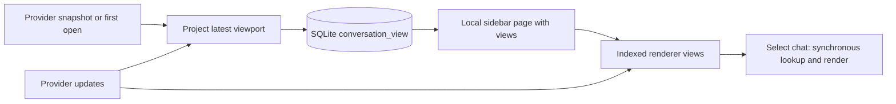

# Durable conversation opening views

Sele owns a persistent read model for conversations it has processed. Chat opening
maps that model to the viewport; it does not hydrate provider history or wait for
a disposable preview cache.

## Known and unknown

A chat becomes known when its first opening view is committed to SQLite. The
ordinary opening IPC commits that view before replying. Background ingestion also
commits a new chat's first view before publishing it as known. Native sidebar
discovery alone does not make an unprocessed conversation known.

`conversation_view` stores one bounded opening viewport per provider/account/source
and chat ID. The viewport contains normalized display items, stable IDs, and page
coordinates. It contains the latest turn, including its user/assistant messages and
bounded progress rows. Older history remains available through the existing paging
APIs; it does not need to mount or parse during selection.

Views have no time-to-live, fingerprint freshness requirement, page-count limit, or
LRU eviction. An empty, active, stopped, failed, or done conversation can be known.
Timestamp/title/status changes update metadata while preserving readable messages.
Disabling the optional recent-chat cache does not disable this read model.

## Opening path

1. `getKnownChats` reads local views and local sidebar metadata before native
   discovery. It performs no transcript hydration or writer-session opening.
2. Each sidebar page carries its views. The renderer installs them and indexes
   their conversation models before publishing the rows as selectable.
3. Selection synchronously looks up the known view and commits it with selection.
   There is no per-selection disk read, provider wait, hover prefetch, or visibility
   preparation. The opening loader is restricted to unknown root conversations.
4. Provider refresh and ownership checks run independently. They replace the local
   display when ready. Failure keeps saved messages visible with an error/retry
   action. Known views do not display a normal “Refreshing messages” loading state.

Provider permission checks remain authoritative. Stored views cannot grant sending,
editing, approvals, or other stale mutation permissions. Process-local revisions
restart normally. Renderer admission distinguishes restored baselines from live
revisions so a delayed list/database reply cannot overwrite a newer live view.

## Ingestion and durability

Provider updates refresh the read model independently of which chat is selected.
After a chat's initial commit, active updates coalesce over 250 ms; completion
flushes promptly. Shutdown awaits pending and in-flight view writes before closing
storage. Background UI deliveries include a ready viewport on first ingestion and
completion; selected chats continue receiving ordinary incremental updates.

Namespaces include the provider, active account identity, environment/runtime, and
chat ID. Confirmed configurations without an active account have a separate empty
account namespace. Account mutations invalidate pending reads/writes. Source keys
prevent host, container, and SSH runtime collisions. Local display state is cleared
on account revision changes, then repopulated from the matching namespace.

The previous expiring `chat_history_page`/`chat_history_turn` cache is legacy storage.
Still-valid legacy pages are adopted into the durable model during discovery. Its
old budgets and freshness rules do not control known conversation views. Chats
whose old projection was already discarded need one initial ingestion to establish
the new durable view.

## Validation

`npm run test:conversation-views` verifies synchronous view mapping, local listing
without discovery, the first-open commit barrier, native SQLite restart, retention
past the old 100-page/age limits, active/done/empty views, paging, unknown IDs, and
account isolation. `npm run test:chat-state` includes the renderer model regressions.

`npm run test:persistent-chat-opening` is a full-app fixture with real SQLite and
withheld provider/discovery replies. It tests first-frame known opening after
restart, changed sidebar timestamps, a disabled recent cache, known empty chats,
unknown-only loading, refresh failure/retry, and mutation gating. Run this GUI
fixture through the isolated-gui helper on a private display and D-Bus session.

These checks prove the opening path does not wait for I/O for known sidebar rows.
Large messages show a bounded text viewport immediately while the worker formats
them; that text remains until the first formatted part commits. They do not insert
a second message-rendering loader. These checks do not assert zero CPU cost for
rendering arbitrary content; bounded/progressive rendering still controls mounting.
